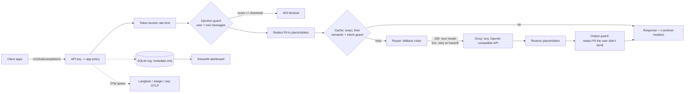

# Sentinel

**An OpenAI-compatible LLM gateway** that sits between your apps and the model provider. It redacts personal data before it leaves your network, blocks prompt-injection attempts, caches repeat questions, falls back to another model when one is rate-limited or down, and traces every request, with guard regressions caught in CI.

Any app that uses an OpenAI SDK switches to it by changing `base_url` and `api_key`.

```python
from openai import OpenAI
client = OpenAI(base_url="http://localhost:8000/v1", api_key="<SENTINEL_KEY_DOCSIGHT>")
client.chat.completions.create(model="llama-3.3-70b-versatile", messages=[{"role": "user", "content": "..."}])
```

## Results

All measured offline with `make eval` on the default detectors (no ML models). Re-run on your machine to refresh.

| Guard | Metric | Result | Set |
| --- | --- | --- | --- |
| Prompt injection (rules) | recall / false-positive rate | 0.95 / 0.02 | 40 attacks + 50 tricky benign prompts, **used during development** |
| Prompt injection (rules) | recall / false-positive rate | run `python eval/run_injection.py --public` | deepset/prompt-injections test split, held out |
| PII redaction (regex) | recall / precision | 1.00 / 1.00 | 210 Faker sentences, 7 entity types, + 20 hard negatives |
| Semantic cache | paraphrase hits / wrong hits | 60% / 0 of 30 (hash embedder, threshold 0.5) | 30 paraphrase + 30 near-miss pairs |
| Gateway overhead | p50 / p95 added latency | ~2 ms / ~4 ms | 300 requests, 20 concurrent, 300 ms fake upstream |

The dev-set injection numbers are optimistic: the rules were tuned on that set (see git history: recall went from 0.70 to 0.95). The held-out public set is the honest measure. The cache numbers use a model-free embedder; run `python eval/run_cache.py --fastembed` for real embeddings.

## How it works



Each app has its own policy in `config/policies.yaml`: PII mode (redact / block / off), injection mode (block / flag / off), cache on/off and threshold, rate limit, and its model fallback chain. The Helpdesk agent has caching turned off because its requests trigger actions.

## Design decisions

- **OpenAI-compatible API**, so adopting it is a config change for every client, and swapping Groq for another provider is one line.
- **PII placeholders, restored on the way out.** The model reasons over `<EMAIL_1>`; the user sees the real address. The mapping lives only in memory for that request and is never logged, cached or traced.
- **Injection: cheap rules first, optional classifier.** Rules cost ~0.1 ms and are explainable (the block reason names the rule). The DeBERTa classifier (`SENTINEL_INJECTION_MODEL=1`) catches paraphrases at ~20-60 ms on CPU. Neither is a complete defence; the real protection is not giving the model authority it shouldn't have.
- **Scan user and tool messages, not system prompts.** Indirect injection arrives through tool results (retrieved docs, emails). System prompts are developer-written and full of "you are...".
- **The cache prefers a miss to a wrong answer.** Embeddings rate "enable 2FA" and "disable 2FA" as near-identical, so a semantic hit must also pass an intent guard: same numbers, identifiers and content words. Requests with PII, tools or temperature > 0 are never cached.
- **Fallback policy by error type.** 429 → next model immediately (a per-minute quota won't clear in 500 ms); 5xx/timeout → retry with exponential backoff; other 4xx → fail fast.
- **Streaming with guards.** All input guards run before the first byte. Placeholders split across chunks (`<EMA` + `IL_1>`) are restored with a small hold-back buffer. Fallback is only possible before the first token is sent.
- **OpenTelemetry, not a vendor SDK**, so traces go to Langfuse, Jaeger or Tempo by changing an env var.
- **Metadata-only logging.** The request log has latency, tokens, cost, cache result and guard decisions, never prompt text.

## Quickstart

```bash
cp .env.example .env     # add GROQ_API_KEY and a gateway key, e.g. SENTINEL_KEY_DEMO=pick-a-long-random-string
make install
make run                 # gateway on :8000
make dashboard           # dashboard on :8501
make test                # 47 tests
make eval && make gate   # guard evals + CI thresholds
```

No Groq key? `SENTINEL_FAKE_UPSTREAM=1 make run` serves canned answers so you can try the guards, cache and dashboard.

Load test: `SENTINEL_FAKE_UPSTREAM=1 make run`, then `SENTINEL_KEY=<key> make load`.

Docker: `docker compose up --build` (gateway + dashboard sharing the log volume). Deploy free on Render or Hugging Face Spaces (Docker); set the keys as secrets.

## Scaling beyond one process

Rate limiter, cache and log are in-process, so run one worker per replica as shipped. To scale out: token buckets in Redis (atomic Lua refill-and-take), cache in Redis with a vector index, log via an async queue into a warehouse, and the injection classifier as its own batched service.

## Layout

```
sentinel/
  app.py         FastAPI: /v1/chat/completions (+ streaming), /v1/models, /metrics, /health
  gateway.py     the request pipeline and streaming restorer
  guards/        pii.py (regex + optional Presidio), injection.py (rules + optional classifier)
  cache.py       exact + semantic cache with intent guard
  providers.py   OpenAI-compatible providers, fallback router, FakeProvider
  policy.py      per-app YAML policies, key auth
  ratelimit.py   token bucket
  store.py       SQLite request log, cost estimates
  tracing.py     OpenTelemetry spans
dashboard.py     Streamlit dashboard
eval/            injection, PII, cache and overhead evals; CI gate; locust load test
config/          policies.yaml
```
